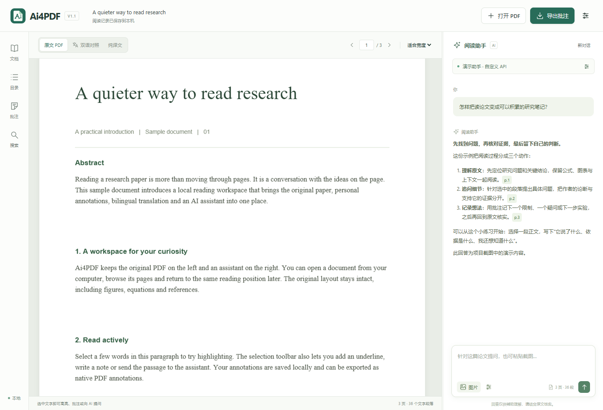
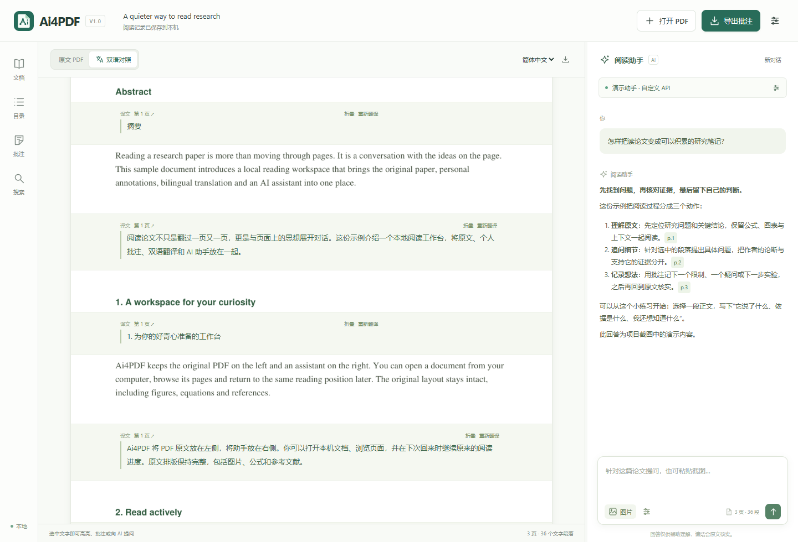

<div align="center">


# Ai4PDF

**A local workspace for reading, translating and discussing research PDFs.**

[](https://github.com/Teslajia/Ai4PDF/releases/latest)
[](LICENSE)

[简体中文](README.md) · [繁體中文](README.zh-TW.md) · English · [日本語](README.ja.md) · [한국어](README.ko.md)

[**Download for Windows**](https://github.com/Teslajia/Ai4PDF/releases/latest) · [Report an issue](https://github.com/Teslajia/Ai4PDF/issues)

</div>

Ai4PDF places the original PDF or paragraph-by-paragraph bilingual view on the left and your own AI assistant on the right. Select a passage to ask a question, highlight a finding, add a note, and keep your documents and reading history on your computer.

The interface runs in your browser, served by a local application. No Ai4PDF account is required. AI features use an API endpoint and model that you configure; no API credits, shared credentials or large language model are bundled.



*Screenshots use the bundled sample document and demonstration responses/translations. No private papers or API keys are shown.*

## Features

- **Original PDFs:** preserve figures, equations and page layout, with selectable text, outline, search and saved reading position.
- **Bilingual reading:** insert translations after original paragraphs; choose a page range, pause/resume, retry one paragraph, or collapse its translation.
- **Annotations:** highlight, underline and comment on original or translated text; click to edit an annotation and drag the note window aside.
- **Annotated PDF export:** export highlights, underlines and notes on the original text as native PDF annotations in a separate file, preserving the original PDF.
- **Your AI:** configure endpoint, model ID, display name and reasoning effort. Ask about selected text, attach images and follow page references. Mathematics renders with KaTeX.
- **Manual segmentation:** split/merge blocks, edit text sent for translation, or exclude figures and equations.
- **Local library:** folders, tags, bulk actions, recycle bin and verified migration.
- **Windows installer:** bundled runtime, desktop shortcut and tray controls; choose your library folder during installation.

Interface and translation targets support **Simplified Chinese, Traditional Chinese, English, Japanese and Korean** independently.



Original regions have an overlaid PDF text layer for selection and copying. The bilingual view preserves original PDF content and inserts web text translations; it does not create a newly typeset bilingual PDF.

## Installation

### Windows 10 / 11, x64

1. Open the [latest Release](https://github.com/Teslajia/Ai4PDF/releases/latest).
2. Download and run `Ai4PDF-1.0.1-windows-x64-setup.exe`.
3. Choose application and library folders. Select an empty folder or an existing Ai4PDF library.
4. Start Ai4PDF. Your browser opens `http://127.0.0.1:8765/`.

**No separate Python or Node.js installation is required.** Alternatively, extract the entire portable ZIP and run `Ai4PDF.exe`. Both editions use the current user's library, rather than storing documents beside the executable.

Closing the browser leaves the local service running; use **Quit** in the tray menu to stop it. Updates preserve an existing library. Uninstall retains documents and library settings. To move existing documents, use Settings > Library migration.

**Updates:** Starting with v1.0.1, use **Settings → Software updates → Check for updates**. The installed edition can download a stable GitHub Release, verify its SHA-256 hash, and **Install update and restart**. It keeps the installation folder, library, annotations, translations, saved settings and local port. Active saving, translation, chat or migration blocks installation. API keys not set to be remembered must be entered again after restarting. Source and portable editions link to the release page for manual updates.

v1.0.0 users need to install v1.0.1 manually once: quit the old app and run the new installer over the existing installation. No uninstall or document reimport is needed.

The installer is unsigned, so Windows may show an unknown-publisher warning. Download from this repository and verify files using `SHA256SUMS.txt`. Source archives and third-party notices accompany the binaries; ordinary users do not need to download them.

### Run from source

Requires Python 3.11+ and Node.js 22+. On Windows:

```powershell
git clone https://github.com/Teslajia/Ai4PDF.git
cd Ai4PDF
powershell -ExecutionPolicy Bypass -File setup.ps1
.\start.cmd
```

Keep the service window open; close it or press `Ctrl+C` to stop. Desktop installers and full desktop validation for macOS/Linux are not currently provided.

## Connect a model

In Settings, enter your API endpoint, actual model ID and API key. You may give the connection an independent display name. Test the connection and save. The button beside image attachments opens quick model/reasoning settings.

Ai4PDF uses **OpenAI-compatible Chat Completions**. Cloud, gateway and local services offering that interface can be configured. Model discovery, image input and reasoning levels depend on the provider/model; unsupported features are not guaranteed. A key may be left blank for a local service without authentication.

## Data and privacy

| Data | Default installed location |
| --- | --- |
| PDFs, annotations, translations, messages, folders, tags and attachments | `%LOCALAPPDATA%\Ai4PDF\data`, or your selected folder |
| Library-location setting | `%LOCALAPPDATA%\Ai4PDF\library-location.json` |
| Startup logs | `%LOCALAPPDATA%\Ai4PDF\logs` |
| API configuration and interface preferences | Current browser; keys stay in page memory unless explicitly remembered in localStorage |

The service binds only to `127.0.0.1`. PDF rendering assets are local. Translation sends source paragraphs to your configured API; chat sends relevant document context, the question, recent conversation and attached images. Connection tests and model discovery also contact that provider. API keys are used for authentication but are not stored in the document library. Update checks and installer downloads contact GitHub without sending documents or AI credentials.

Back up the **entire library directory** after stopping the service. Migration copies and verifies files before switching, and retains the original directory as a backup.

## Current limitations

- **No OCR:** image-only scans require an external text layer for selection and translation. Password-protected PDFs must be unlocked first.
- **No bilingual PDF export:** export an annotated original PDF or bilingual Markdown. Translation annotations are recorded as text rather than placed on a nonexistent translated PDF page.
- **Heuristic segmentation:** complex tables, fonts or columns may need manual correction. Figures and standalone equations are preserved and excluded from translation where detected.
- **Verify AI output:** formula correctness depends on model output. Long documents use selected passages rather than unlimited full-text context.
- **Local, single-user application:** not configured as a public multi-user server; prefer one editing tab per document.

## Development and license

Built with Flask, PyMuPDF, PDF.js, KaTeX, Marked and DOMPurify; packaged with Waitress, PyInstaller and Inno Setup.

See [CONTRIBUTING.md](CONTRIBUTING.md), [build/release instructions](RELEASE.md), [Chinese usage guide](docs/USAGE.zh-CN.md) and [CHANGELOG.md](CHANGELOG.md).

Licensed under **[GNU AGPL-3.0](LICENSE)**. Dependencies retain their own licenses. Source and notices accompany Releases; `_internal/legal` also contains Ai4PDF source and licenses.

The project page structure was inspired by [PDFMathTranslate](https://github.com/PDFMathTranslate/PDFMathTranslate). Ai4PDF does not currently integrate its translation engine.
