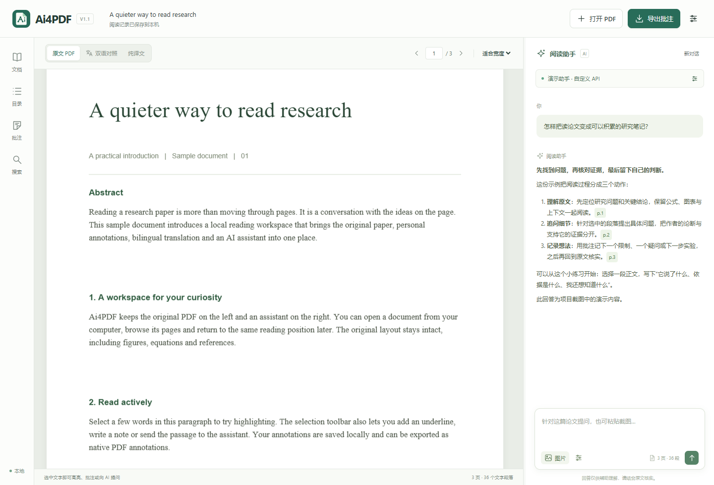
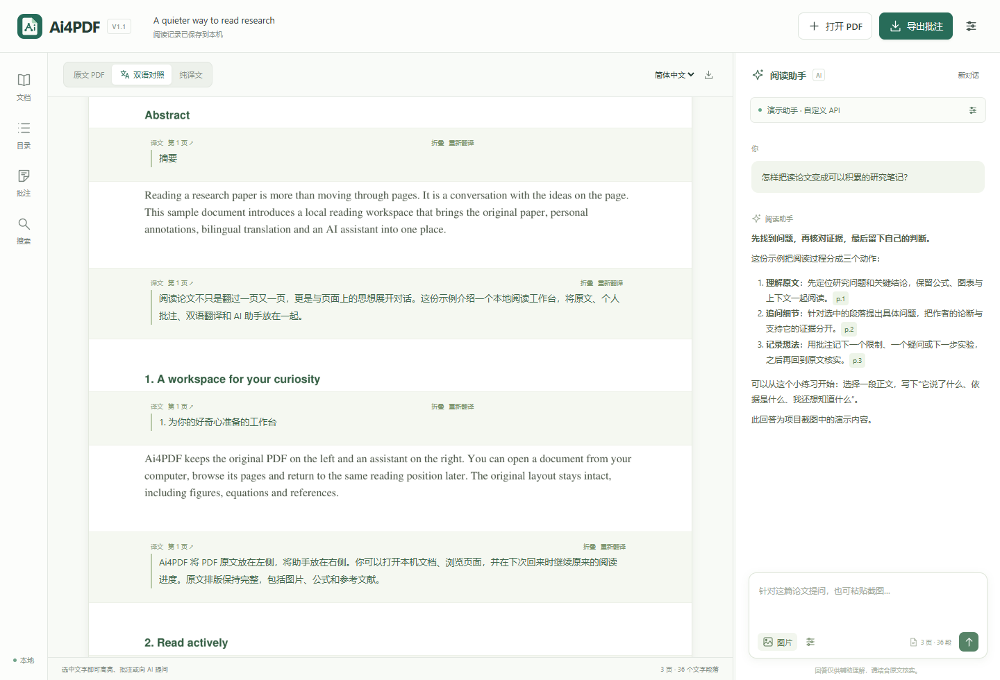
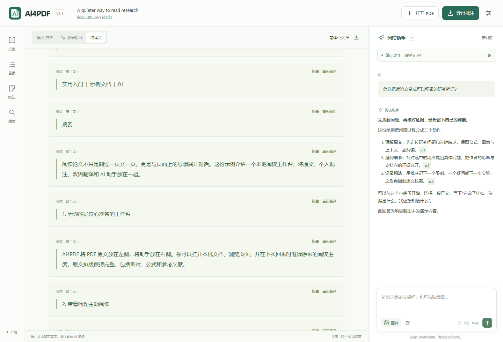

<div align="center">


# Ai4PDF

**論文を読み、問い、発見を積み重ねる。**

PDF 原文、対訳、注釈、AI チャットをひとつにまとめたローカルの論文閲覧アプリ。

[](https://github.com/Teslajia/Ai4PDF/releases/latest)
[](https://github.com/Teslajia/Ai4PDF/releases/latest)
[](LICENSE)

[简体中文](README.md) · [繁體中文](README.zh-TW.md) · [English](README.en.md) · 日本語 · [한국어](README.ko.md)

[**Windows 版をダウンロード**](https://github.com/Teslajia/Ai4PDF/releases/latest) · [使い方（簡体字中国語）](docs/USAGE.zh-CN.md) · [問題を報告](https://github.com/Teslajia/Ai4PDF/issues)

</div>

## Ai4PDF について

**Ai4PDF は、論文を読むためのローカル PDF・AI アプリです。** 左側に PDF 原文または段落ごとの対訳を表示し、右側には自分で設定した AI モデルを接続できます。わからない箇所を選択して質問したり、重要な内容にハイライトやメモを付けたり、注釈付き PDF を書き出したりできます。

PDF、注釈、訳文、会話は自分のパソコンに保存されます。Ai4PDF のアカウント登録は不要です。ローカルサーバーがブラウザーに閲覧画面を表示し、AI チャットと翻訳には自分で設定した API を使用します。互換 API を提供するローカルモデルにも接続できます。



*画像は付属のサンプル PDF とデモ用の翻訳・回答を使用しています。個人の論文や API キーは含まれていません。*

## 主な機能

| 機能 | 内容 |
| --- | --- |
| 📄 原文の閲覧 | PDF の文字、図、数式、レイアウトを保持。文字の選択とコピー、目次、検索、参考文献への移動と復帰、ページ内の読書位置の復元に対応 |
| 🌐 対訳 / 訳文のみ | 原文と訳文の対照、または訳文のみの閲覧。全文・指定ページの翻訳、一時停止と再開、段落単位の再翻訳、折りたたみに対応。表示を切り替えても対応する段落に移動 |
| ✍️ ハイライトと注釈 | 原文・訳文にハイライト、下線、メモを追加。マークをクリックして編集でき、メモウィンドウも移動可能 |
| 📤 注釈付き PDF の出力 | 原文のハイライト、下線、メモを PDF 標準の注釈として別ファイルに出力し、元の PDF を保持 |
| 🤖 自分の AI を接続 | API アドレス、キー、モデル ID、表示名、推論強度を設定。画像添付、選択箇所への質問、数式表示、ページ参照に対応 |
| 🧩 段落分割の手動修正 | ブロックの分割・結合、翻訳に送る文字の修正、翻訳しない領域の指定が可能 |
| 🗂️ ローカルライブラリ | フォルダー、タグ、検索、一括操作、ごみ箱、ファイルをコピー・検証してから切り替える保存先移行 |
| 🖥️ Windows インストーラー | Python / Node.js の別途インストールは不要。デスクトップショートカット、トレイメニュー、ライブラリ保存先の選択に対応 |

画面の言語と翻訳先は、それぞれ **简体中文、繁體中文、English、日本語、한국어** から独立して選択できます。



対訳画面では元の PDF の図文を残し、対応する段落の後に Web のテキストとして訳文を挿入します。原文領域には PDF のテキストレイヤーを重ねているため、文字を選択してコピーできます。独立した数式、図中の文字、ヘッダー・フッターは検出できた範囲で翻訳対象から除外します。複雑なレイアウトは手動で修正できます。

## ダウンロードとインストール

## v1.1.0 の新機能

- **図表を含む訳文表示**：対訳タブの右側にある「訳文のみ」を選ぶと、翻訳と認識された元の図・表・独立した数式を読む順序で表示します。図表のキャプションには保存済みの訳文を使用します。文字レイヤーがある図表は文字の選択・コピー・注釈追加に対応し、拡大表示もできます。
- **図表・数式認識の改善**：キャプション、複数の図、座標軸、ラベルを組み合わせて領域を認識し、表と見出しの対応を保持します。PDF のクリッピングで隠された図形を除外し、小さな図の過剰な拡大を防ぎます。縦長の図もウィンドウに合わせて縦横比を維持します。
- **参考文献と読書位置**：PDF 内蔵リンクや `[1]`、`[2, 3]`、`[4–6]` などの認識可能な番号付き引用から移動し、元の位置に戻れます。原文・対訳・訳文のみの表示を切り替えても対応する位置に移動します。
- **設定の改善**：モデルと API が対応する推論強度を表示し、非対応の保存済み設定を既定値に戻します。設定ダイアログの角丸も統一しました。

各表示は保存済みの翻訳と注釈を共有し、切り替え時に翻訳 API を再呼び出ししません。既存文書を開き直すと認識キャッシュを更新し、ライブラリ、手動分割、保存済み設定は保持します。図表内の文字は原文のままです。Markdown は対訳または訳文のみを出力でき、図表は含めません。詳細は [変更履歴](CHANGELOG.md) を参照してください。

### Windows 10 / 11、x64

1. [最新の Release](https://github.com/Teslajia/Ai4PDF/releases/latest) から `Ai4PDF-1.1.0-windows-x64-setup.exe` をダウンロードします。
2. インストーラーを実行し、アプリと**文書ライブラリ**の保存先を選択します。空のフォルダー、または既存の Ai4PDF ライブラリを指定できます。
3. デスクトップまたはスタートメニューから起動すると、ブラウザーで `http://127.0.0.1:8765/` が開きます。
4. PDF を開いて閲覧を始めます。翻訳や質問を使う場合は、自分の AI API を設定してください。

**Python や Node.js の別途インストールは不要です。** ポータブル版 `*-windows-x64-portable.zip` をすべて展開して `Ai4PDF.exe` を起動することもできます。どちらの版もユーザーのライブラリを使用し、文書をプログラムのフォルダーには保存しません。

ブラウザーを閉じてもローカルサービスは終了しません。終了するときはトレイメニューの **退出 / Quit** を選択してください。更新時は既存のライブラリを保持し、アンインストール後も文書と保存先設定は残ります。文書の移動には設定画面のライブラリ移行機能を使用してください。

**更新の確認：** v1.0.1 以降では **設定 → ソフトウェア更新 → 更新を確認** から GitHub の最新正式版を確認できます。インストール版はインストーラーのダウンロードと SHA-256 検証後、更新して再起動できます。アプリの場所、ライブラリ、保存済み設定、ローカルのポート番号を引き継ぎます。保存・翻訳・チャット・ライブラリ移行中はインストールを開始しません。保存を指定していない API キーは再起動後に再入力が必要です。ソース版とポータブル版はリリースページから手動で更新してください。

v1.0.0 には更新機能がないため、旧アプリを終了し、v1.1.0 を直接上書きインストールしてください。中間バージョンのインストールは不要です。アンインストールや文書の再取り込みは不要です。

インストーラーはコード署名されていないため、Windows が不明な発行元として警告する場合があります。このリポジトリから入手し、Release の `SHA256SUMS.txt` で検証してください。対応するソースと第三者ライセンス情報も同梱していますが、通常のインストールには不要です。

### ソースから実行する

**Python 3.11+、Node.js 22+** が必要です。Windows で以下を実行します。

```powershell
git clone https://github.com/Teslajia/Ai4PDF.git
cd Ai4PDF
powershell -ExecutionPolicy Bypass -File setup.ps1
.\start.cmd
```

サービスのウィンドウは開いたままにしてください。閉じるか `Ctrl+C` で停止できます。macOS / Linux 向けのデスクトップインストーラーは未提供で、デスクトップ動作の検証も完了していません。



## AI の接続設定

右上の設定画面で **API アドレス、実際のモデル ID、API キー**を入力します。接続の表示名はモデル ID と別に付けられます。接続テスト後に保存してください。画像添付の隣の小さな設定ボタンから、モデルや推論強度をすばやく変更できます。

**OpenAI 互換の Chat Completions API** を使用します。この API を提供するクラウド、ゲートウェイ、ローカルサービスを設定できます。モデル一覧の取得、画像入力、推論強度はサービスとモデルの対応状況に依存します。認証不要のローカルサービスではキーを空欄にできます。**Ai4PDF に API 利用枠、共有キー、大規模言語モデルは付属しません。**

## 出力とデータ保存

右上の出力ボタンから、**原文のハイライト、下線、メモ**を PDF 標準の注釈として保存できます。元の PDF は上書きせず、別ファイルを生成します。対訳は Markdown で出力できます。訳文に付けた注釈はテキストとして記録し、原文 PDF の存在しない訳文領域には配置しません。

| データ | インストール版の既定の場所 |
| --- | --- |
| PDF、注釈、訳文、会話、フォルダー、タグ、画像添付 | `%LOCALAPPDATA%\Ai4PDF\data`、または指定したライブラリ |
| ライブラリの保存先設定 | `%LOCALAPPDATA%\Ai4PDF\library-location.json` |
| 起動ログ | `%LOCALAPPDATA%\Ai4PDF\logs` |
| API 設定と画面の設定 | 現在のブラウザー。キーは通常ページのメモリー内のみで、保存を選択した場合だけ localStorage に保存 |

サービスは `127.0.0.1` のみで待ち受けます。PDF 表示用のリソースはローカルにあります。翻訳時は対象の原文を、チャット時は関連する文書の内容・質問・最近の会話・添付画像を、設定した API に送信します。接続テストやモデル一覧の取得もそのサービスにアクセスします。API キーは認証に使用しますが、文書ライブラリには保存しません。更新の確認とダウンロードは GitHub に接続し、文書や AI の認証情報は送信しません。

バックアップはサービスを終了してから**ライブラリ全体**をコピーしてください。保存先の移行はコピーと検証の後に切り替え、元のフォルダーをバックアップとして残します。ブラウザーのデータを削除すると API 設定などは失われますが、ローカルライブラリの文書は削除されません。

## 現在の制限

- **OCR は未搭載：** 画像だけのスキャン文書で文字の選択や翻訳を行うには、外部ツールでテキストレイヤーを追加する必要があります。暗号化された PDF は先にロックを解除してください。
- **対訳 PDF の出力は未対応：** 注釈付きの原文 PDF と対訳 Markdown を出力できます。対訳 Web 画面の改ページは元の PDF と一致しません。
- **複雑な段組みは手動修正が必要な場合があります：** 特殊なフォント、表、段をまたぐ数式などは正しく分割されないことがあります。
- **AI の回答は原文と照合してください：** 数式の正確さはモデル出力に依存します。長い文書は関連する段落を選んで参照するため、常に全文をモデルへ渡すわけではありません。
- **個人のローカル利用向け：** 公開の複数ユーザー用サーバーとしては設定されていません。同じ文書を編集するタブはひとつにすることを推奨します。

## 開発とライセンス

Flask、PyMuPDF、PDF.js、KaTeX、Marked、DOMPurify を使用しています。Windows 版は Waitress、PyInstaller、Inno Setup で配布しています。

[使い方](docs/USAGE.zh-CN.md)、[ビルドとリリース](RELEASE.md)、[貢献ガイド](CONTRIBUTING.md)、[変更履歴](CHANGELOG.md)も参照してください（これらは簡体字中国語です）。問題は [Issues](https://github.com/Teslajia/Ai4PDF/issues) へ、OS・バージョン・再現手順を添えて報告できます。API キーや非公開文書は添付しないでください。

ライセンスは **[GNU AGPL-3.0](LICENSE)** です。依存ライブラリには各ライセンスが適用されます。対応するソースとライセンス情報を Release に添付し、`_internal/legal` にも Ai4PDF のソースとライセンスを含めています。

[PyMuPDF](https://github.com/pymupdf/PyMuPDF)、[PDF.js](https://github.com/mozilla/pdf.js)、[KaTeX](https://github.com/KaTeX/KaTeX) などの開発者に感謝します。紹介ページの構成は [PDFMathTranslate](https://github.com/PDFMathTranslate/PDFMathTranslate) を参考にしましたが、現在その翻訳エンジンは組み込んでいません。
