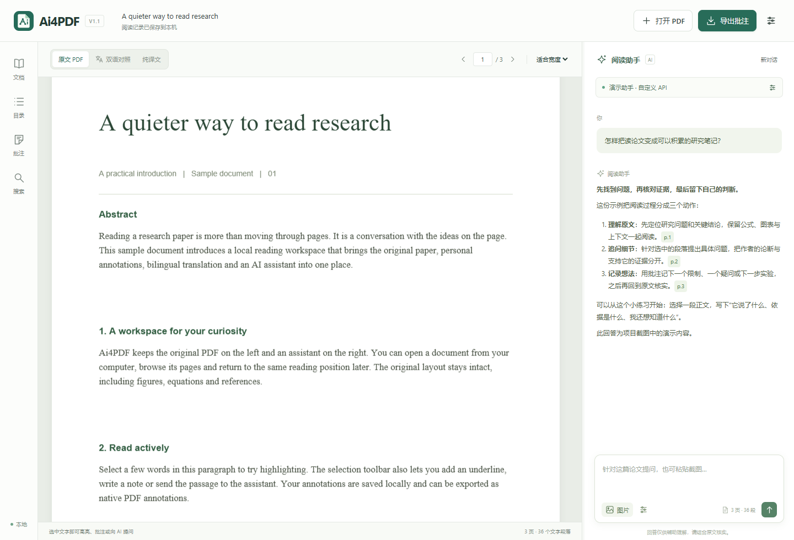
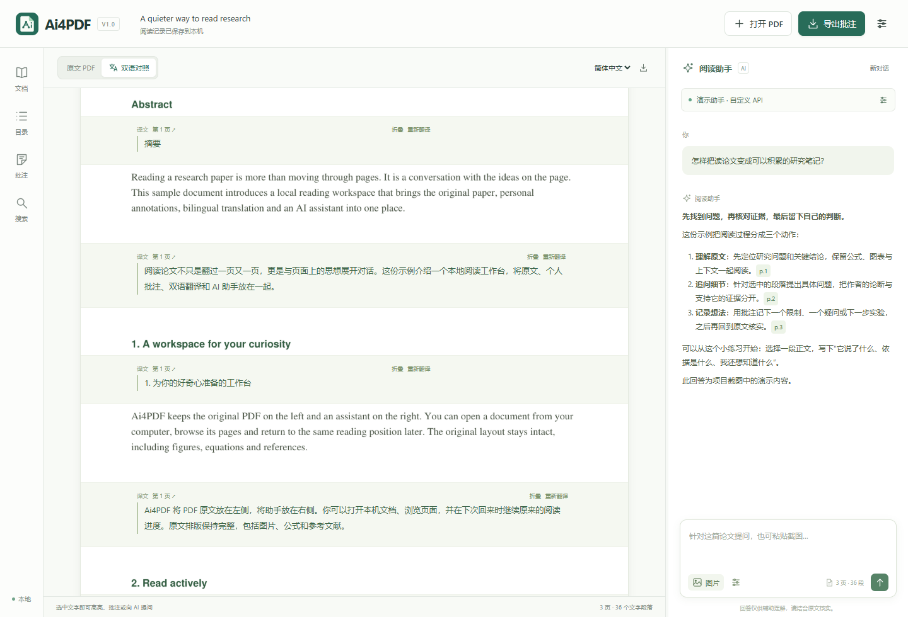

<div align="center">


# Ai4PDF

**논문을 읽고, 질문하고, 발견을 쌓아 가세요.**

PDF 원문, 문단별 번역, 주석과 AI 대화를 한곳에서 사용하는 로컬 논문 읽기 도구입니다.

[](https://github.com/Teslajia/Ai4PDF/releases/latest)
[](https://github.com/Teslajia/Ai4PDF/releases/latest)
[](LICENSE)

[简体中文](README.md) · [繁體中文](README.zh-TW.md) · [English](README.en.md) · [日本語](README.ja.md) · 한국어

[**Windows 설치 파일 다운로드**](https://github.com/Teslajia/Ai4PDF/releases/latest) · [사용 안내（중국어 간체）](docs/USAGE.zh-CN.md) · [문제 신고](https://github.com/Teslajia/Ai4PDF/issues)

</div>

## 프로젝트 소개

**Ai4PDF는 논문 읽기를 위한 로컬 PDF·AI 도구입니다.** 왼쪽에서 PDF 원문이나 문단별 원문·번역을 읽고, 오른쪽에서는 직접 설정한 AI 모델과 대화할 수 있습니다. 이해하기 어려운 문장을 선택해 질문하거나, 중요한 부분에 형광펜·밑줄·메모를 추가하고, 주석이 포함된 PDF로 내보낼 수 있습니다.

PDF, 주석, 번역과 대화는 내 컴퓨터에 저장됩니다. Ai4PDF 계정을 만들 필요가 없습니다. 로컬 서버가 브라우저에 읽기 화면을 제공하며, AI 대화와 번역에는 사용자가 설정한 API를 사용합니다. 호환 API를 제공하는 로컬 모델도 연결할 수 있습니다.



*스크린샷에는 기본 제공 예제 PDF와 시연용 번역·답변을 사용했습니다. 개인 논문이나 API 키는 포함되어 있지 않습니다.*

## 주요 기능

| 기능 | 설명 |
| --- | --- |
| 📄 원문 읽기 | PDF의 글자, 그림, 수식과 레이아웃을 유지합니다. 텍스트 선택·복사, 목차, 검색과 읽던 위치 복원을 지원합니다. |
| 🌐 원문·번역 대조 | 원문 문단 뒤에 번역을 표시합니다. 전체 또는 지정한 페이지 범위 번역, 일시 정지·재개, 문단별 재번역, 접기·펼치기를 지원합니다. |
| ✍️ 강조와 주석 | 원문과 번역에 형광펜, 밑줄, 메모를 추가합니다. 표시를 클릭해 빠르게 편집하고 메모 창을 이동할 수 있습니다. |
| 📤 주석 PDF 내보내기 | 원문의 형광펜, 밑줄, 메모를 PDF 기본 주석으로 별도 파일에 내보내며, 원본 PDF를 보존합니다. |
| 🤖 내 AI 연결 | API 주소, 키, 모델 ID, 표시 이름과 추론 강도를 설정합니다. 이미지 첨부, 선택한 내용 질문, 수식 표시와 페이지 인용을 지원합니다. |
| 🧩 문단 수동 조정 | 자동 분할이 부정확하면 블록을 나누거나 합치고, 번역할 텍스트를 수정하거나 특정 영역을 번역에서 제외할 수 있습니다. |
| 🗂️ 로컬 문서 라이브러리 | 폴더, 태그, 검색, 일괄 관리, 휴지통과 파일을 복사·검증한 후 저장 위치를 전환하는 이전 기능을 제공합니다. |
| 🖥️ Windows 설치 버전 | Python / Node.js를 별도로 설치할 필요가 없습니다. 바탕 화면 바로 가기와 트레이 메뉴를 제공하며, 설치 중 라이브러리 위치를 선택할 수 있습니다. |

화면 언어와 번역 대상 언어는 각각 **简体中文、繁體中文、English、日本語、한국어** 중에서 독립적으로 선택할 수 있습니다.



대조 화면은 원본 PDF의 내용을 유지하면서 해당 문단 뒤에 웹 텍스트 형태의 번역을 삽입합니다. 원문 영역에는 PDF 텍스트 레이어가 겹쳐 있어 글자를 선택하고 복사할 수 있습니다. 별도로 배치된 수식, 그림 내부 글자, 머리글과 바닥글은 감지되는 범위에서 번역 대상에서 제외합니다. 복잡한 레이아웃은 수동으로 수정할 수 있습니다.

## 다운로드와 설치

### Windows 10 / 11, x64

1. [최신 Release](https://github.com/Teslajia/Ai4PDF/releases/latest)에서 `Ai4PDF-1.0.1-windows-x64-setup.exe`를 다운로드합니다.
2. 설치 파일을 실행한 뒤 프로그램과 **문서 라이브러리**의 위치를 선택합니다. 빈 폴더 또는 기존 Ai4PDF 라이브러리를 지정할 수 있습니다.
3. 바탕 화면이나 시작 메뉴에서 실행하면 브라우저에 `http://127.0.0.1:8765/`가 열립니다.
4. PDF를 열어 읽기를 시작합니다. 번역이나 질문 기능을 사용하려면 자신의 AI API를 설정하세요.

**Python이나 Node.js를 별도로 설치할 필요가 없습니다.** 포터블 버전 `*-windows-x64-portable.zip`의 압축을 모두 풀고 `Ai4PDF.exe`를 실행해도 됩니다. 두 버전 모두 현재 사용자의 라이브러리를 사용하며, 문서를 프로그램 폴더에 저장하지 않습니다.

브라우저를 닫아도 로컬 서비스는 계속 실행됩니다. 종료하려면 트레이 메뉴에서 **退出 / Quit**를 선택하세요. 업데이트 시 기존 라이브러리를 유지하고, 프로그램을 제거해도 문서와 라이브러리 위치 설정은 남습니다. 문서를 옮길 때는 설정의 라이브러리 이전 기능을 사용하세요.

**업데이트 확인:** v1.0.1부터 **설정 → 소프트웨어 업데이트 → 업데이트 확인**에서 GitHub의 최신 정식 버전을 확인할 수 있습니다. 설치 버전은 파일을 다운로드하고 SHA-256을 검증한 뒤 업데이트를 설치하고 재시작할 수 있습니다. 기존 설치 폴더, 라이브러리, 저장된 설정과 로컬 포트를 유지합니다. 저장·번역·대화·라이브러리 이전이 진행 중이면 설치를 시작하지 않습니다. 기억하도록 설정하지 않은 API 키는 재시작 후 다시 입력해야 합니다. 소스 및 포터블 버전은 릴리스 페이지에서 수동으로 업데이트하세요.

v1.0.0에는 업데이트 메뉴가 없으므로 기존 프로그램을 종료하고 v1.0.1을 한 번 수동으로 덮어 설치해야 합니다. 프로그램 제거나 문서 재가져오기는 필요하지 않습니다.

설치 파일에는 코드 서명이 없어 Windows가 알 수 없는 게시자 경고를 표시할 수 있습니다. 이 저장소에서 다운로드하고 Release의 `SHA256SUMS.txt`로 검증하세요. 해당 소스 코드와 서드파티 라이선스 안내도 제공하지만 일반 설치에는 별도로 다운로드할 필요가 없습니다.

### 소스 코드로 실행

**Python 3.11+, Node.js 22+**가 필요합니다. Windows에서 다음을 실행하세요.

```powershell
git clone https://github.com/Teslajia/Ai4PDF.git
cd Ai4PDF
powershell -ExecutionPolicy Bypass -File setup.ps1
.\start.cmd
```

서비스 창을 열어 두세요. 창을 닫거나 `Ctrl+C`를 누르면 종료됩니다. macOS / Linux용 데스크톱 설치 파일은 아직 제공하지 않으며, 전체 데스크톱 동작 검증도 완료되지 않았습니다.

## AI 연결 설정

오른쪽 위 설정에서 **API 주소, 실제 모델 ID와 API 키**를 입력합니다. 연결의 표시 이름은 모델 ID와 별도로 정할 수 있습니다. 연결을 테스트한 뒤 저장하세요. 이미지 첨부 옆의 작은 설정 버튼으로 모델과 추론 강도를 빠르게 바꿀 수 있습니다.

**OpenAI 호환 Chat Completions API**를 사용합니다. 이 API를 제공하는 클라우드, 게이트웨이 또는 로컬 서비스를 설정할 수 있습니다. 모델 목록 조회, 이미지 이해와 추론 강도는 서비스 및 모델의 지원 여부에 따라 다릅니다. 인증이 필요 없는 로컬 서비스라면 키를 비워 둘 수 있습니다. **Ai4PDF는 모델 사용 크레딧, 공유 API 키 또는 대규모 언어 모델을 포함하지 않습니다.**

## 내보내기와 데이터 저장

오른쪽 위 내보내기 버튼으로 **원문에 추가한 형광펜, 밑줄, 메모**를 PDF 기본 주석이 포함된 별도 파일로 저장할 수 있습니다. 원본 PDF는 덮어쓰지 않습니다. 원문·번역은 Markdown으로 내보낼 수 있습니다. 번역 주석은 텍스트로 기록하며, 원본 PDF에 존재하지 않는 번역 영역에 배치하지 않습니다.

| 데이터 | 설치 버전의 기본 위치 |
| --- | --- |
| PDF, 주석, 번역, 대화, 폴더, 태그와 첨부 이미지 | `%LOCALAPPDATA%\Ai4PDF\data` 또는 선택한 라이브러리 폴더 |
| 라이브러리 위치 설정 | `%LOCALAPPDATA%\Ai4PDF\library-location.json` |
| 시작 로그 | `%LOCALAPPDATA%\Ai4PDF\logs` |
| API 설정과 화면 환경설정 | 현재 브라우저. 키는 기본적으로 페이지 메모리에만 있으며, 기억하기를 선택한 경우에만 localStorage에 저장됩니다. |

서비스는 `127.0.0.1`에서만 요청을 받습니다. PDF 표시 리소스는 로컬에 있습니다. 번역 시에는 해당 원문을, 대화 시에는 관련 문서 내용·질문·최근 대화·첨부 이미지를 설정한 API로 전송합니다. 연결 테스트와 모델 목록 조회도 해당 서비스에 접속합니다. API 키는 인증에 사용하지만 문서 라이브러리에 저장하지 않습니다. 업데이트 확인과 다운로드는 GitHub에 접속하며, 문서나 AI 인증 정보는 전송하지 않습니다.

백업하려면 서비스를 종료한 뒤 **라이브러리 폴더 전체**를 복사하세요. 저장 위치 이전은 파일을 복사·검증한 후 전환하고, 원래 폴더는 백업으로 남겨 둡니다. 브라우저 데이터를 지우면 API 설정 등은 사라질 수 있지만 로컬 라이브러리의 문서는 삭제되지 않습니다.

## 현재 제한 사항

- **OCR 미포함:** 이미지로만 된 스캔 문서에서 텍스트 선택과 번역을 하려면 외부 도구로 텍스트 레이어를 추가해야 합니다. 암호화된 PDF는 먼저 잠금을 해제하세요.
- **대조 PDF 내보내기 미지원:** 주석이 있는 원문 PDF와 원문·번역 Markdown을 내보낼 수 있습니다. 대조 웹 화면의 페이지 구분은 원본 PDF와 같지 않습니다.
- **복잡한 문서 구조는 수동 수정이 필요할 수 있습니다:** 특수 글꼴, 표, 여러 단에 걸친 수식 등은 정확히 분할되지 않을 수 있습니다.
- **AI 답변은 원문과 대조하세요:** 수식의 정확성은 모델 출력에 따라 달라집니다. 긴 문서는 관련 문단을 선택해 참조하므로 항상 전체 문서를 모델에 전달하지는 않습니다.
- **개인 로컬 사용을 위한 도구입니다:** 공개 다중 사용자 서버로 구성되어 있지 않습니다. 같은 문서는 하나의 탭에서 편집하는 것을 권장합니다.

## 개발과 라이선스

Flask, PyMuPDF, PDF.js, KaTeX, Marked와 DOMPurify를 사용합니다. Windows 버전은 Waitress, PyInstaller와 Inno Setup으로 패키징합니다.

[사용 안내](docs/USAGE.zh-CN.md), [빌드와 릴리스](RELEASE.md), [기여 안내](CONTRIBUTING.md), [변경 이력](CHANGELOG.md)도 참고하세요（해당 문서는 중국어 간체입니다）. [Issues](https://github.com/Teslajia/Ai4PDF/issues)에 운영체제, 버전과 재현 단계를 첨부해 문제를 신고할 수 있습니다. API 키나 비공개 문서는 첨부하지 마세요.

라이선스는 **[GNU AGPL-3.0](LICENSE)**입니다. 의존성에는 각각의 라이선스가 적용됩니다. 해당 소스와 라이선스 안내를 Release에 첨부하며, 설치 폴더의 `_internal/legal`에도 Ai4PDF 소스와 라이선스를 포함합니다.

[PyMuPDF](https://github.com/pymupdf/PyMuPDF), [PDF.js](https://github.com/mozilla/pdf.js), [KaTeX](https://github.com/KaTeX/KaTeX) 등 오픈 소스 프로젝트에 감사드립니다. 소개 페이지 구성은 [PDFMathTranslate](https://github.com/PDFMathTranslate/PDFMathTranslate)를 참고했지만, 현재 해당 번역 엔진을 포함하지는 않습니다.
