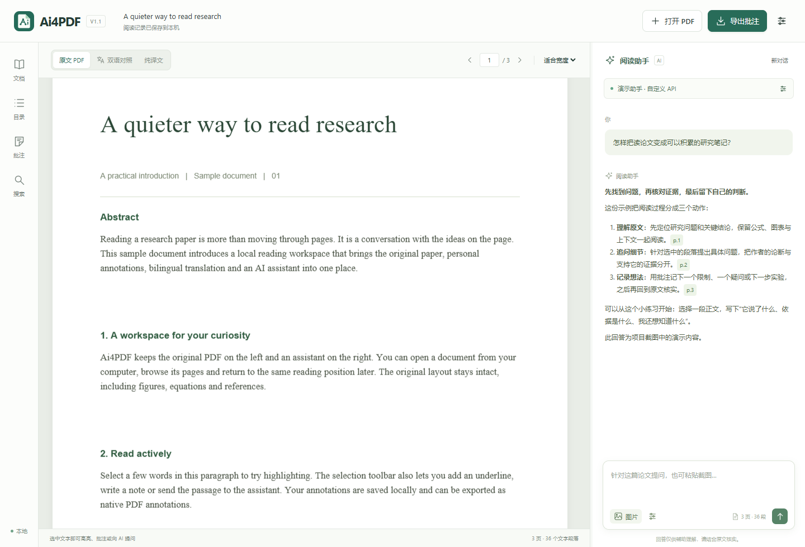
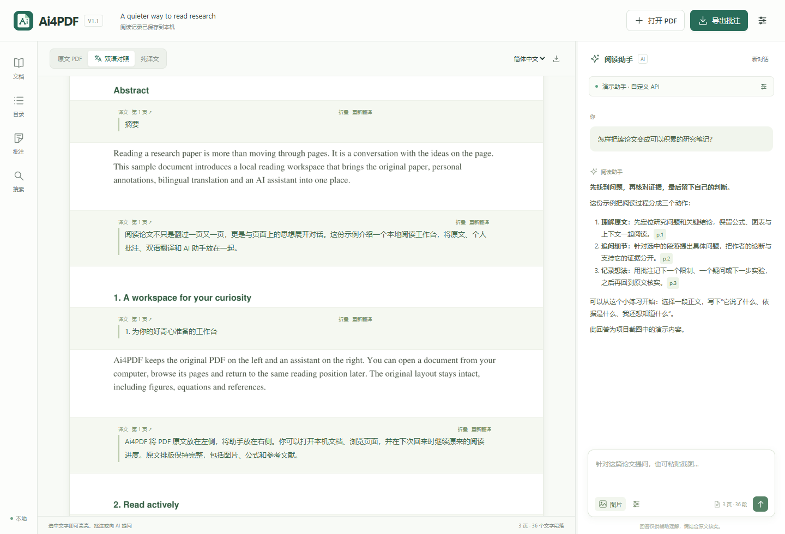
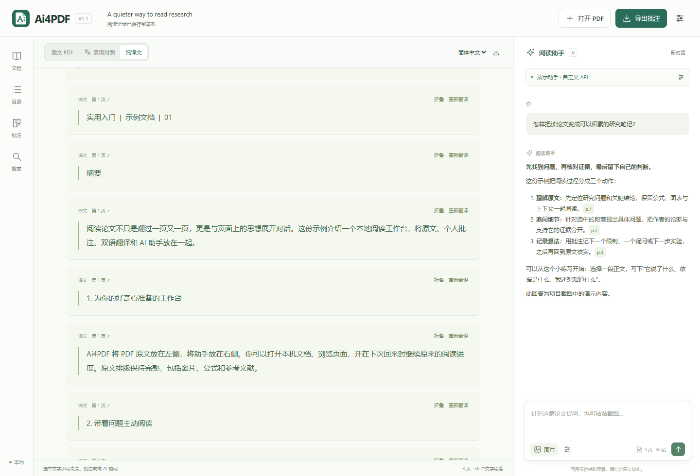

<div align="center">


# Ai4PDF · PDF_AI助手

**科研有嘉，探索有新**

把 PDF 原文、双语翻译、阅读批注和 AI 问答放在同一个本地工作台。

[](https://github.com/Teslajia/Ai4PDF/releases/latest)
[](https://github.com/Teslajia/Ai4PDF/releases/latest)
[](LICENSE)

简体中文 · [繁體中文](README.zh-TW.md) · [English](README.en.md) · [日本語](README.ja.md) · [한국어](README.ko.md)

[**下载安装版**](https://github.com/Teslajia/Ai4PDF/releases/latest) · [使用指南](docs/USAGE.zh-CN.md) · [常见问题](#常见问题) · [反馈问题](https://github.com/Teslajia/Ai4PDF/issues)

</div>

## 项目介绍

**Ai4PDF 是面向论文阅读的本地 PDF + AI 工作台。** 左侧阅读原文或逐段双语对照，右侧连接你自己的 AI 模型。读到不理解的段落，可以选中提问；读到值得记录的内容，可以划线、批注并导出带批注的 PDF。

PDF、批注、译文和对话保存在本机，无需注册 Ai4PDF 账号。阅读界面由本地服务打开在浏览器中；AI 问答和翻译使用你自行配置的 API，也可连接提供兼容接口的本机模型。



*截图使用项目自带的示例 PDF；译文和问答为演示内容，不包含私人论文或 API Key。*

## 主要功能

| 功能 | 可以做什么 |
| --- | --- |
| 📄 原文阅读 | 保留 PDF 文字、图片、公式和版面；选字复制、目录、搜索、参考文献跳转与返回、页内阅读位置恢复 |
| 🌐 双语对照 / 纯译文 | 按段落插入译文或只看译文，翻译全文或指定起止页；暂停续译、单段重译、折叠 / 展开，切换视图定位对应段落 |
| ✍️ 划线批注 | 原文和译文支持高亮、下划线、笔记；单击标记快速编辑，笔记窗口可拖动 |
| 📤 批注 PDF 导出 | 将原文高亮、下划线和笔记导出为 PDF 原生批注，生成独立文件，保留原始 PDF |
| 🤖 自定义 AI | API 地址、Key、模型 ID、显示名称和思考强度；图片附件、选区提问、公式显示和页码引用 |
| 🧩 手动调整 | 自动分段不准时，可切分、合并、修正待译文字，或将指定块设为不翻译 |
| 🗂️ 本地文档库 | 文件夹分类、标签、搜索、批量管理、回收站，以及复制校验后切换的文档库迁移 |
| 🖥️ Windows 安装版 | 无需另装 Python / Node.js；桌面快捷方式、自动打开浏览器、托盘退出；安装时选择文档库 |

界面语言和翻译目标均支持 **简体中文、繁體中文、English、日本語、한국어**，两者可分别设置。



> 双语阅读保留原 PDF 页面内容，在对应段落后插入网页译文。原文图文区域叠加可选中的文字层，并非只能看截图。独立公式、图片内部文字和页眉页脚会尽量排除翻译；复杂排版仍可手动调整。

## v1.1.0 更新

- **带图表的纯译文**：在“双语对照”右侧选择“纯译文”，按阅读顺序查看译文、原图、表格和独立公式；图注、表注沿用对应译文。有文字层的图表可选字、复制、批注，并支持放大查看。
- **更准确的图表与公式识别**：结合图注、子图、坐标轴和标签识别完整区域；表格与标题保持关联，过滤 PDF 中被裁剪隐藏的图形。小图不再拉满整栏，长图等比适应窗口。
- **引用跳转与阅读位置**：原文和译文支持 PDF 内链及可识别的 `[1]`、`[2, 3]`、`[4–6]` 等编号式引用；跳转后可返回，切换原文、双语、纯译文时定位对应位置。
- **设置优化**：思考强度按模型及接口能力筛选，修正不受支持的旧设置；统一设置弹窗圆角。

三个阅读视图共用已有译文和批注，切换不会重复调用翻译 API。旧文档重新打开时自动更新识别缓存，保留文档库、手动切分及已保存设置。图内文字保持原样；Markdown 可导出双语或纯译文，暂不嵌入图表。完整变化见 [更新记录](CHANGELOG.md)。



## 下载与安装

### Windows 安装版（推荐）

适用于 **Windows 10 / 11，64 位 x64**。

1. 打开 [最新 Release](https://github.com/Teslajia/Ai4PDF/releases/latest)，下载 `Ai4PDF-1.1.0-windows-x64-setup.exe`。
2. 双击安装，分别选择程序安装位置和**本地文档库位置**。可选择空文件夹，或已有的 Ai4PDF 文档库。
3. 从桌面或开始菜单启动 **Ai4PDF**，浏览器自动打开 `http://127.0.0.1:8765/`。
4. 点击“打开 PDF”开始阅读；需要翻译或问答时，再配置自己的 AI API。

关闭网页不会退出服务。要停止 Ai4PDF，请在任务栏通知区域的托盘菜单中选择 **退出 / Quit**。升级和卸载保留个人文档；已有资料的库在升级时保持原位置，迁移请使用应用内设置。

**检查更新：** 从 v1.0.1 起，打开 **设置 → 软件更新 → 检查更新**。发现 GitHub 正式版后，安装版可下载安装包，校验完成后点击 **安装更新并重启**。更新沿用安装目录、文档库、批注、译文及已保存设置，并在原端口重启；正在保存、翻译、问答或迁移时不会开始安装。未勾选记住的 API Key 仍只存在页面内存，重启后需重新输入。源码版和便携版通过「发布页面」手动下载更新。

v1.0.0 尚无检查更新入口，可直接手动覆盖安装 v1.1.0，无需先装中间版本。退出旧程序后运行新安装包覆盖安装即可，无需卸载或重新导入文档。

| Release 文件 | 用途 |
| --- | --- |
| `*-windows-x64-setup.exe` | Windows 安装程序，普通用户下载此文件即可 |
| `*-windows-x64-portable.zip` | 免安装版，完整解压后运行 `Ai4PDF.exe`；数据仍保存在当前用户的文档库中 |
| `*-source.zip` | Ai4PDF 对应版本的源码与构建脚本 |
| `pymupdf-*.tar.gz`、`mupdf-*-source.tar.gz` | 第三方组件对应源码，普通用户无需下载 |
| `SHA256SUMS.txt`、`THIRD_PARTY_NOTICES.md` | 文件校验清单和第三方许可说明 |

当前安装包尚未代码签名，Windows 可能提示“未知发布者”。请从本仓库 Release 下载；校验方法见 [发布说明](RELEASE.md)。

### 从源码运行

需要 **Python 3.11+、Node.js 22+**。Windows 下：

```powershell
git clone https://github.com/Teslajia/Ai4PDF.git
cd Ai4PDF
powershell -ExecutionPolicy Bypass -File setup.ps1
.\start.cmd
```

源码版需保持服务窗口打开，关闭窗口或按 `Ctrl+C` 停止。非 Windows 平台尚未提供安装包，也未完成完整的桌面验证。

## 配置你的 AI

打开右上角 **设置 → 连接你的 AI**：

| 设置 | 说明 |
| --- | --- |
| 显示名称 | 自由命名，例如“我的科研助手”；与实际模型 ID 独立 |
| API 地址 | 你的服务地址，支持基础地址、`/v1` 或完整 `/chat/completions` 地址 |
| 实际模型 ID | 服务商提供的真实模型 ID；服务支持时可获取可用模型列表 |
| API Key | 使用自己的凭据；无需鉴权的本机服务可留空 |
| 思考强度 | 默认跟随模型设置；仅在模型和服务商支持时调整 |

点击“测试连接”后保存。输入框旁的小设置按钮可快速切换模型和思考强度。

目前使用 **OpenAI 兼容的 Chat Completions 接口**。提供该接口的云端服务、中转或本机服务均可尝试接入；模型列表、图片理解、思考强度等能力取决于具体服务。**Ai4PDF 不附带模型额度、共享 API Key 或内置大语言模型。**

## 常用操作

- **阅读和问答**：在右侧提问，或选中原文后点击“问 AI”；支持粘贴 / 添加图片。回答中的页码可点击返回原文。
- **指定页翻译**：切换“双语对照”，选择目标语言、起止页码后开始。完成的译文会保留，可暂停和继续。
- **修正分段**：在双语“原版图文”页面点击“调整切分”，切分、合并或勾选“此块不翻译”后保存。
- **做笔记**：选中文字后高亮、下划线或批注。单击已有标记，点击“编辑”快速修改。
- **导出**：支持带原文批注的 PDF 和双语 Markdown；译文批注以文本记录处理，不会凭空写到原 PDF 的译文位置。
- **管理资料**：左侧“文档 → 管理文档库”支持分类和批量操作。删除先进入回收站，彻底删除需再次确认。

更多操作与保存规则见 [完整使用指南](docs/USAGE.zh-CN.md)。

## 文档保存在哪里？

| 内容 | 安装版默认位置 |
| --- | --- |
| PDF、批注、译文、对话、分类和聊天图片 | `%LOCALAPPDATA%\Ai4PDF\data`，安装时可选择其他位置 |
| 文档库位置配置 | `%LOCALAPPDATA%\Ai4PDF\library-location.json` |
| 启动日志 | `%LOCALAPPDATA%\Ai4PDF\logs` |
| API 配置、界面偏好 | 当前浏览器；Key 默认仅在页面内存，勾选“记住”后才进入 localStorage |

设置里可查看实际目录，或迁移到另一个空文件夹。迁移会复制、校验后切换，原目录保留为备份。备份时请先退出服务，再复制整个文档库，勿只复制 PDF。

**网络使用**：本地服务只监听 `127.0.0.1`，PDF 阅读资源不依赖远程 CDN。翻译向配置的 API 发送相应原文；问答发送文档上下文、问题、最近对话和所附图片。测试连接和获取模型列表也会访问配置的服务。API Key 不写入文档库，但服务商会收到用于鉴权的 Key。检查更新和下载安装包会连接 GitHub，不发送文档或 AI 凭据。

## 常见问题

**翻译或 AI 问答为什么不能直接使用？**  
需要自己的 API 地址、模型 ID 和 Key。先测试连接，并确认服务商的额度、限流和模型能力。原文阅读、批注和文档管理不需要 AI API。

**图片和公式会重新翻译吗？**  
独立公式与图片保留原貌，尽量不送入翻译；行内数学要求模型保留。特殊字体、跨栏公式或复杂表格可能识别不准，可手动修正分段和不翻译区域。

**能导出排版一致的双语 PDF 吗？**  
当前支持带原文批注的 PDF 和双语 Markdown，**尚不支持导出重新排版的双语 PDF**。双语阅读会拉长网页，分页不等同原 PDF。

**扫描件能直接识别文字吗？**  
当前未集成 OCR。扫描件可显示，但需先用外部工具添加文字层，才能选择文字和逐段翻译。加密 PDF 需先解锁。

**关闭窗口或卸载会丢失资料吗？**  
文档库独立保存，卸载不会清空。清理浏览器数据会影响 API 配置等偏好，但不会删除本地服务目录中的文档。重要资料仍建议定期备份。

**启动提示端口被占用怎么办？**  
先退出旧版 Ai4PDF 或占用 8765 端口的程序。同一配置重复启动会打开已有服务，程序不会替你结束其他进程。

## 开发与贡献

后端使用 Flask、PyMuPDF，前端使用原生 ES Modules、PDF.js、KaTeX、Marked 和 DOMPurify。Windows 版使用 Waitress、PyInstaller 与 Inno Setup。

- [使用指南](docs/USAGE.zh-CN.md)：功能行为、数据结构和限制。
- [构建与发布](RELEASE.md)：依赖锁定、安装包构建、迁移和校验。
- [贡献指南](CONTRIBUTING.md)：测试、问题反馈和 Pull Request。
- [更新记录](CHANGELOG.md)：版本变化。

欢迎通过 [Issues](https://github.com/Teslajia/Ai4PDF/issues) 反馈。请提供系统、版本、复现步骤和可公开的最小示例，避免附带 API Key 或私密文档。

## 许可与致谢

Ai4PDF 使用 **[GNU AGPL-3.0](LICENSE)**。第三方组件保留各自版权和许可；Release 提供对应源码和第三方声明，安装目录中的 `_internal/legal` 也包含 Ai4PDF 源码和许可证。

感谢 [PyMuPDF](https://github.com/pymupdf/PyMuPDF)、[PDF.js](https://github.com/mozilla/pdf.js)、[KaTeX](https://github.com/KaTeX/KaTeX) 等开源项目。项目首页的组织方式参考了 [PDFMathTranslate](https://github.com/PDFMathTranslate/PDFMathTranslate)；Ai4PDF 的当前实现未集成其翻译引擎。
