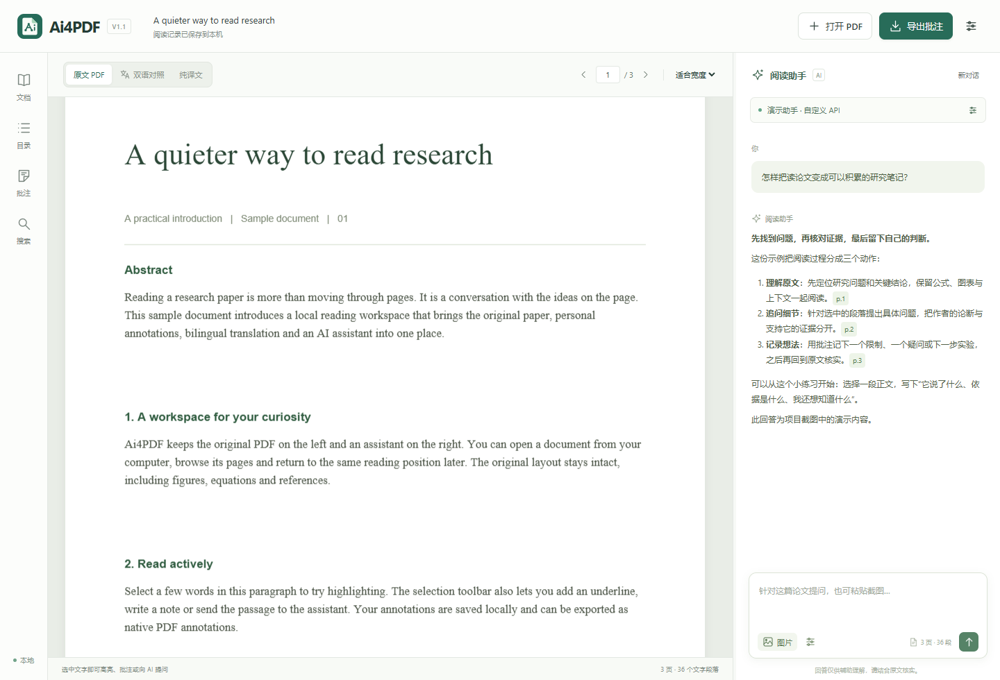
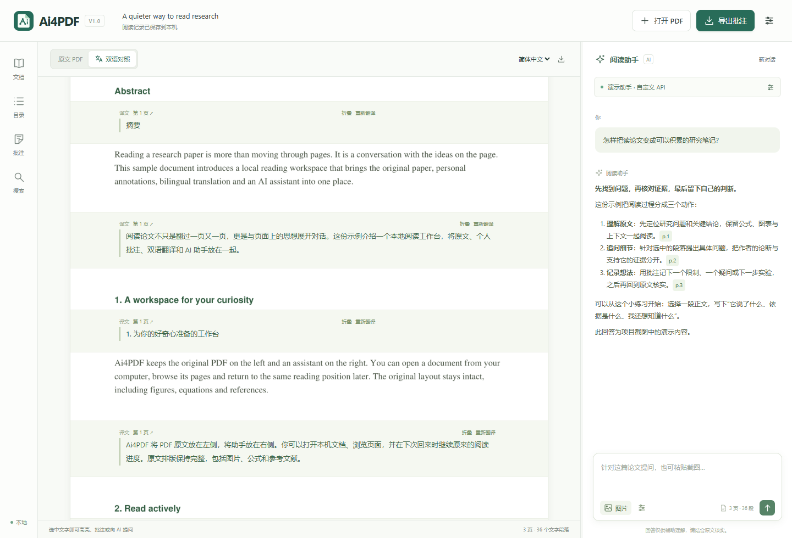

<div align="center">


# Ai4PDF · PDF_AI助手

**科研有嘉，探索有新**

將 PDF 原文、雙語翻譯、閱讀註解與 AI 問答整合在同一個本機工作空間。

[](https://github.com/Teslajia/Ai4PDF/releases/latest)
[](https://github.com/Teslajia/Ai4PDF/releases/latest)
[](LICENSE)

[简体中文](README.md) · 繁體中文 · [English](README.en.md) · [日本語](README.ja.md) · [한국어](README.ko.md)

[**下載 Windows 安裝版**](https://github.com/Teslajia/Ai4PDF/releases/latest) · [使用指南（簡體中文）](docs/USAGE.zh-CN.md) · [回報問題](https://github.com/Teslajia/Ai4PDF/issues)

</div>

## 專案介紹

**Ai4PDF 是為論文閱讀設計的本機 PDF + AI 工作空間。** 左側閱讀原文或逐段雙語對照，右側連接你自己的 AI 模型。遇到不理解的段落，可選取文字提問；遇到值得記錄的內容，可畫線、加上註解，再匯出含註解的 PDF。

PDF、註解、譯文與對話儲存在本機，不需要註冊 Ai4PDF 帳號。閱讀介面由本機服務在瀏覽器中提供；AI 問答與翻譯使用你自行設定的 API，也能連接提供相容介面的本機模型。



*截圖使用專案內附的範例 PDF；譯文與問答為示範內容，不包含私人論文或 API Key。*

## 主要功能

| 功能 | 說明 |
| --- | --- |
| 📄 原文閱讀 | 保留 PDF 文字、圖片、公式與版面；支援選字複製、目錄、搜尋與閱讀進度還原 |
| 🌐 雙語對照 | 在原文段落後插入譯文；翻譯全文或指定頁碼範圍，暫停與繼續、單段重譯、收合與展開 |
| ✍️ 畫線註解 | 原文與譯文可標示重點、加底線與筆記；點選標記快速編輯，筆記視窗可拖曳 |
| 📤 匯出註解 PDF | 將原文的重點標示、底線與筆記匯出為 PDF 原生註解，另存新檔並保留原始 PDF |
| 🤖 自訂 AI | 設定 API 位址、Key、模型 ID、顯示名稱與思考強度；支援圖片附件、選取文字提問、公式顯示與頁碼引用 |
| 🧩 手動調整 | 自動分段不準確時，可切分、合併、修正待譯文字，或將指定區塊設為不翻譯 |
| 🗂️ 本機文件庫 | 資料夾分類、標籤、搜尋、批次管理、資源回收筒，以及複製並驗證後切換的文件庫移轉 |
| 🖥️ Windows 安裝版 | 不需另外安裝 Python / Node.js；提供桌面捷徑、通知區域選單，安裝時可選擇文件庫位置 |

介面語言與翻譯目標都支援 **简体中文、繁體中文、English、日本語、한국어**，兩者可分別設定。



雙語閱讀保留原 PDF 圖文，在對應段落後插入網頁譯文。原文區域疊加可選取的文字層，可選字與複製。獨立公式、圖片內文字與頁首頁尾會盡量排除翻譯；複雜版面仍可手動修正。

## 下載與安裝

### Windows 10 / 11，x64

1. 開啟[最新 Release](https://github.com/Teslajia/Ai4PDF/releases/latest)，下載 `Ai4PDF-1.0.1-windows-x64-setup.exe`。
2. 執行安裝程式，分別選擇程式與**本機文件庫**位置。可選空資料夾，或既有的 Ai4PDF 文件庫。
3. 從桌面或開始功能表啟動 Ai4PDF，瀏覽器會開啟 `http://127.0.0.1:8765/`。
4. 開啟 PDF 開始閱讀；需要翻譯或問答時，再設定自己的 AI API。

**不需另外安裝 Python 或 Node.js。** 也可下載 `*-windows-x64-portable.zip`，完整解壓縮後執行 `Ai4PDF.exe`。兩種版本都使用目前使用者的文件庫，文件不放在程式目錄中。

關閉網頁不會停止本機服務；請透過通知區域選單的 **退出 / Quit** 結束程式。升級保留既有文件庫，解除安裝也會保留文件與位置設定。若要搬移文件，請使用設定中的文件庫移轉功能。

**檢查更新：** 自 v1.0.1 起，可在 **設定 → 軟體更新 → 檢查更新** 取得 GitHub 最新正式版。安裝版可下載並驗證 SHA-256，接著安裝更新並重新啟動。升級沿用原安裝位置、文件庫、已儲存設定與連接埠；儲存、翻譯、問答或移轉尚未完成時不會開始安裝。未勾選記住的 API Key 需在重新啟動後再次輸入。原始碼版與可攜版請從發佈頁面手動更新。

v1.0.0 尚無更新入口，需要先退出舊程式，再手動覆蓋安裝 v1.0.1 一次；不需解除安裝或重新匯入文件。

目前安裝程式未進行程式碼簽署，Windows 可能提示未知的發行者。請從本儲存庫下載，並使用 Release 的 `SHA256SUMS.txt` 核對檔案。對應原始碼與第三方聲明也隨 Release 提供，一般使用者不必另外下載。

### 從原始碼執行

需要 **Python 3.11+、Node.js 22+**。Windows 下執行：

```powershell
git clone https://github.com/Teslajia/Ai4PDF.git
cd Ai4PDF
powershell -ExecutionPolicy Bypass -File setup.ps1
.\start.cmd
```

請保持服務視窗開啟；關閉視窗或按 `Ctrl+C` 即可停止。macOS / Linux 尚未提供桌面安裝程式，也尚未完成完整的桌面驗證。

## 設定 AI

在右上角設定中填入 **API 位址、實際模型 ID 與 API Key**，可另設與模型 ID 無關的顯示名稱。測試連線後儲存；圖片附件旁的小設定按鈕可快速切換模型與思考強度。

目前使用 **OpenAI 相容的 Chat Completions 介面**。可連接提供該介面的雲端、轉接或本機服務；模型清單、圖片理解與思考強度取決於服務與模型支援。無需驗證身分的本機服務可留空 Key。**Ai4PDF 不附帶模型額度、共用 API Key 或內建大型語言模型。**

## 匯出與資料保存

右上角的匯出按鈕可將**原文的重點標示、底線與筆記**另存成含 PDF 原生註解的檔案，不覆寫原始 PDF。雙語內容可匯出為 Markdown；譯文註解以文字記錄，不會寫入原 PDF 中不存在的譯文位置。

| 資料 | 安裝版預設位置 |
| --- | --- |
| PDF、註解、譯文、對話、分類、標籤與附件 | `%LOCALAPPDATA%\Ai4PDF\data`，或安裝時選擇的位置 |
| 文件庫位置設定 | `%LOCALAPPDATA%\Ai4PDF\library-location.json` |
| 啟動記錄 | `%LOCALAPPDATA%\Ai4PDF\logs` |
| API 設定與介面偏好 | 目前瀏覽器；Key 預設只存在頁面記憶體，勾選記住後才存入 localStorage |

服務僅監聽 `127.0.0.1`，PDF 閱讀資源不依賴遠端 CDN。翻譯會將相應原文傳送至你設定的 API；問答會傳送文件上下文、問題、近期對話與附件圖片。測試連線與取得模型清單也會連接該服務。Key 用於驗證身分，但不寫入文件庫。檢查與下載更新會連接 GitHub，不傳送文件或 AI 憑證。

備份時請先退出服務，再複製**整個文件庫**。移轉會先複製並驗證檔案，再切換目錄，原目錄保留為備份。清除瀏覽器資料會影響 API 設定等偏好，不會刪除本機文件庫。

## 目前限制

- **未內建 OCR：** 純圖片掃描檔需先透過其他工具加入文字層，才能選字與逐段翻譯。加密 PDF 需先解鎖。
- **尚不支援雙語 PDF 匯出：** 目前支援含原文註解的 PDF 與雙語 Markdown，雙語網頁分頁不等同原 PDF。
- **複雜版面可能需調整：** 特殊字型、表格、跨欄公式可能分段不準，可手動切分、合併或排除翻譯。
- **請核對 AI 回答：** 公式與回答正確性取決於模型輸出；長篇文件使用選取的相關段落，不代表無限制的全文上下文。
- **本機單人使用：** 未設定為公開的多人伺服器；同一文件建議只用一個分頁編輯。

## 開發、授權與致謝

後端使用 Flask、PyMuPDF；前端使用 PDF.js、KaTeX、Marked 與 DOMPurify。Windows 版以 Waitress、PyInstaller 與 Inno Setup 封裝。

延伸閱讀：[使用指南](docs/USAGE.zh-CN.md)、[建置與發佈](RELEASE.md)、[貢獻指南](CONTRIBUTING.md)、[更新記錄](CHANGELOG.md)（以上為簡體中文）。歡迎在 [Issues](https://github.com/Teslajia/Ai4PDF/issues) 提供版本、系統與重現步驟，請勿附上 API Key 或私人文件。

Ai4PDF 採用 **[GNU AGPL-3.0](LICENSE)**。第三方元件保留各自版權與授權；Release 提供對應原始碼與聲明，安裝目錄的 `_internal/legal` 也包含 Ai4PDF 原始碼與授權文字。

感謝 [PyMuPDF](https://github.com/pymupdf/PyMuPDF)、[PDF.js](https://github.com/mozilla/pdf.js)、[KaTeX](https://github.com/KaTeX/KaTeX) 等開源專案。首頁組織方式參考 [PDFMathTranslate](https://github.com/PDFMathTranslate/PDFMathTranslate)；目前未整合其翻譯引擎。
